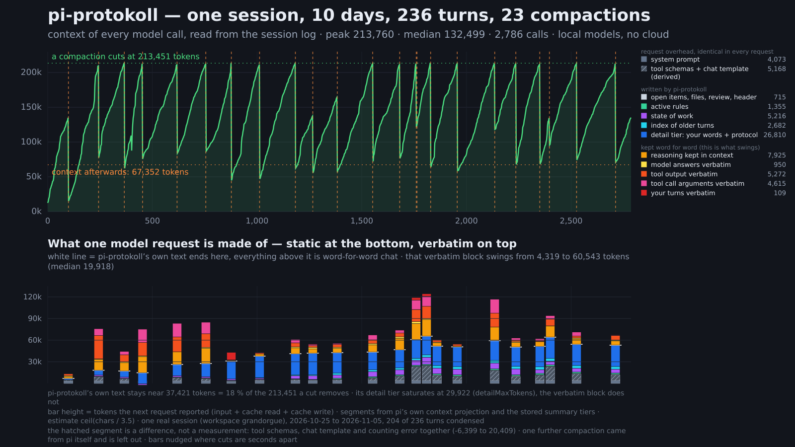

# pi-protokoll



Eine [Pi](https://pi.dev)-Erweiterung für sehr lange Sitzungen mit lokalen Modellen: Das Modell
schreibt am Ende jedes Zugs ein kurzes Protokoll, und das Compacting baut daraus eine
begrenzte, gestufte Zusammenfassung, statt den ganzen Verlauf noch einmal lesen und
zusammenfassen zu lassen.

*English version: [README.md](README.md)*

## Warum

Pis eigenes Compacting schickt den alten Verlauf ans Modell und wartet, bis es eine
Zusammenfassung geschrieben hat. Mit einem lokalen Modell dauert das bei langen Sitzungen
Minuten, und die Zusammenfassung entsteht im Nachhinein aus einem überfüllten Kontext.

Hier passiert die teure Arbeit während der Arbeit: Jede abschließende Antwort endet mit einem
Protokollblock, geschrieben solange das Modell den Zug noch vollständig vor sich hat. Beim
Compacting liegt fast alles schon vor; Code setzt die Zusammenfassung zusammen, das Modell
schreibt nur noch eine kurze Übersicht fort.

Gemessen in einer Sitzung mit Qwen3.x an einem lokalen OpenAI-kompatiblen Server
(2× RTX 3090, 262k Kontextfenster):

- 22 Compactings über 118 Züge, jeweils etwa **213.000 → 35.000 Token in rund 30 s**
- die Wiederaufnahme der Sitzung liest etwa 36.000–44.000 Token
- jeder frühere Zug bleibt über Werkzeuge erreichbar

In der 12-Tage-Sitzung aus der Grafik oben, ebenfalls mit einem lokalen Qwen-Modell, senkt ein Schnitt den
Kontext von etwa 213.000 Token auf im Median etwa 67.000 im nächsten Request; rund 38.000 davon sind die
Zusammenfassung, der Rest sind Systemprompt und wörtlich Erhaltenes. Zwischen den Schnitten hält der Prefix-Cache (KV-Cache)
des Servers: Im Median-Request kamen 99,8 % der Prompt-Token daraus. Der Request direkt nach einem Schnitt
hat nur noch den Systemprompt im Cache und liest einmalig etwa 62.000 Token neu. Eingespart wird der Lauf
zur Neu-Zusammenfassung, nicht dieses erneute Einlesen.

Praxisbeispiel: [64kdemo](https://github.com/sebion7125/64kdemo), eine prozedurale Waldlandschaft in C und OpenGL, mit Bildern, Kamerafahrt und Entstehungsgeschichte. Die ersten zehn Sitzungen liefen ohne die Erweiterung und endeten immer wieder in Kontextvergiftung; mit der Erweiterung blieb es ab dem Baumsystem eine einzige Sitzung, die oben gemessene.

## Ablauf

Ein *Zug* ist ein Arbeitslauf: deine Nachricht samt allen Werkzeugrunden bis zur
abschließenden Antwort. Nachrichten, die du schreibst, während das Modell noch arbeitet,
gehören zum laufenden Zug. Antworten, die ein Frage-Werkzeug als `custom_message` liefert
(eigener Input des Nutzers durch ein Paket, etwa `ask_user` von pi-web), beginnen den Zug, der
mit ihnen arbeitet; ihr Text bleibt mit `keepUserMessages` im Wortlaut erhalten.

1. **Systemprompt.** Ein fester Abschnitt bittet das Modell, jede abschließende Antwort mit
   einem `<protocol>`-Block zu beenden: `result`, `decision`, `files`, `open`, `rule`, `revoke`,
   `index`, `tags`. Der Text ändert sich nie, damit der Präfix-Cache des Servers gültig bleibt. Er
   sagt einmal, was das Modell über die Länge einer Sitzung wissen kann (siehe *Bekannte Grenzen*).
2. **Antwort fertig.** Der Block wird aus der Antwort geschnitten und als Sitzungseintrag
   gespeichert, eingeklappt angezeigt (`▸ protocol turn 7: …`). Steht der Block früh, bleibt der
   Text danach in der Antwort; ein in Code oder im Satz zitiertes Tag wird nicht angefasst. Die
   Zugnummer vergibt die Erweiterung, nicht das Modell.
3. **Block fehlt.** Einmalige Nachforderung mit unverändertem Kontext plus kurzer Anweisung.
   Der Prompt beginnt wie der gerade gelaufene, ein Präfix-Cache liest also nur die neuen Token.
   Gespeichert wird nur der Block, nicht der Austausch. Ignoriert das Modell die Nachforderung, wird der Block
   sofort aus dem Transkript des Zugs geschrieben.
4. **Zug abgebrochen** (Esc, Fehler, Ausgabelimit). Bevor deine nächste Nachricht rausgeht,
   wird das Protokoll des abgebrochenen Zugs geschrieben: was erledigt ist, was offen bleibt.
   Werkzeugaufrufe aus Gewohnheit werden mit „Werkzeuge nicht verfügbar“ beantwortet, nicht
   ausgeführt. Klappt das nicht, folgt ein zweiter Versuch aus dem Transkript des Zugs.
5. **Compacting.** Pi löst wie gewohnt aus. Die Zusammenfassung hat Stufen mit harten Grenzen:

   | Stufe | Inhalt | Grenze |
   |---|---|---|
   | vollständig | die letzten Züge im Original | `keepRecentTurns`, höchstens `keepRecentPercent` % des Fensters |
   | Detail | die nächstälteren Züge: **deine Nachricht im Wortlaut** + Protokoll; angeheftete Züge im vollen Text; Züge ohne Protokoll als gekürztes Transkript | `detailMaxTokens` |
   | Stand | alles davor | `statusMaxTokens` |

   Der **Stand** besteht aus
   - einem **Index**, einer Zeile pro älterem Zug: der `index`-Zeile, die das Modell mit diesem
     Zug geschrieben hat. Code setzt ihn bei jedem Compacting neu aus den gespeicherten
     Protokollen zusammen, er kann also nicht driften. Passt er nicht mehr, werden die ältesten
     Züge zu Bereichszeilen aus ihren `tags` zusammengelegt
     (`[T1–T20] Blattpalette (T14, T16); DEMO_LEAFPAL (T14); Impostor-Atlas (T18–T19)`);
   - den geltenden **Vorgaben** (`rule` abzüglich `revoke`), den **offenen Punkten** und den
     **geänderten Dateien**, von Code aus den Protokollen übernommen;
   - einer **Zustandsbeschreibung**, dem einzigen Teil, den das Modell neu schreibt: Es bekommt
     die bisherige Beschreibung und die Protokolle der Züge, die gerade aus der Detailstufe
     fallen. Große Rückstände gehen in Teilen zu je `foldChunkTokens`.

   Ein **Prüflauf** lässt das Modell Vorgaben und offene Punkte aufräumen. Es kann nur per
   Nummer auswählen (`RULES: R1, R4`), also nichts umformulieren oder erfinden.

   Scheitert etwas, oder würde der Kontext nicht klein genug, gibt die Erweiterung ab und Pi
   kompaktiert auf seine Art. Der Chat blockiert nie.

6. **Nachschlagen** für das Modell:
   - `protocol_read("12, 40-44")` liefert die gespeicherten Protokolle samt deiner Nachricht,
   - `protocol_search(query)` findet Züge über Stichwörter (Tags zählen doppelt),
   - `protocol_turn(n)` liefert das Originaltranskript eines Zugs.

7. **Umschalten mitten in der Sitzung.** `/protokoll off` lässt Systemprompt und Werkzeugliste
   byte-genau unverändert und fügt an der aktuellen Position eine Nachricht ein, die die Regeln
   zurücknimmt; die drei `protocol_*`-Werkzeuge bleiben angemeldet und antworten
   `pi-protokoll is disabled`. Genau das hält den Präfix-Cache. `/protokoll on` setzt es wieder in
   Kraft: Der Abschnitt steht noch im Prompt, deshalb bringt ihn eine kurze Nachricht zurück. Eine
   Sitzung, die von Anfang an ohne pi-protokoll lief, hatte den Abschnitt nie im Präfix – auch beim
   Einschalten kommt er nicht in den Präfix, sondern einmalig als Nachricht mit den Regeln. Ältere
   Züge haben keine Protokolle und werden als gekürzte Transkripte kompaktiert; `/protokoll repair`
   schreibt ihre Protokolle. Die harte Variante `/protokoll off --strip` entfernt den Abschnitt
   wirklich und meldet die Werkzeuge ab; die nächste Anfrage verarbeitet den ganzen Kontext neu
   (einmalig). Pi kopiert die Systemnachricht des Zweigs auf den Compacting-Eintrag, daher überlebt
   der Prompt (Abschnitt inklusive) ein Compacting, während eine Nachricht weggeschnitten werden
   kann. Am ersten Abschluss nach einem Compacting nimmt die Erweiterung Nachrichten aus dem
   Kontext, die dem Zustand widersprechen (`context_edit` mit leerem Ersatz); fehlt eine nötige
   Zurücknahme, verlässt stattdessen der Abschnitt den Prompt.

Während des Compactings und der Nachträge zeigt ein Widget über dem Eingabefeld den
Fortschritt. Danach zeigt es die neue Kontextgröße, bis zur nächsten Nachricht, weil Pi den
Chat nach dem Compacting neu zeichnet.

Jedes Compacting speichert zusätzlich einen eigenen Status-Eintrag (`protokoll-compact`): wie
es ausgegangen ist, die Gesamtzeit, die Zeit jedes Schritts und die Meldungszeilen des Ablaufs. Die Dauer ist damit auch lange nach dem Widget noch lesbar – in der Konsole und überall,
wo Session-Einträge dargestellt werden, zum Beispiel im Browser. `/protokoll export` listet die
Zeit jedes Compactings.

Während ein Durchlauf läuft, wird jeder Schritt zusätzlich über Pi's gemeinsamen Extensions-Bus
(Kanal `pi-protokoll:progress`, siehe `ProgressEvent` in `src/core.ts`) gemeldet, damit eine andere
Extension die laufenden Schritte live zeigen kann. Jede Meldung trägt den ganzen Durchlauf: pro
Schritt der Zustand, die eigene Zeit, wie viele Zeichen das Modell schon geschrieben hat und ob es
denkt oder schreibt – derselbe Status, den das Widget in der Konsole zeigt. Diese Zeilen werden nie
in der Session abgelegt – der Status-Eintrag pro Durchlauf bleibt das Protokoll.

## Installation

```bash
pi install git:github.com/sebion7125/pi-protokoll
```

oder aus einem lokalen Ordner:

```bash
pi install ./pi-protokoll
```

Pi neu starten (oder `/reload`), dann `/protokoll status`.

Konfiguration ist optional: `protokoll.example.json` nach `~/.pi/agent/protokoll.json`
kopieren und anpassen; pro Projekt überschreibt `<projekt>/.pi/protokoll.json`.

**Umstieg von der manuellen Installation** (`~/.pi/agent/extensions/protokoll/`): diesen Ordner
löschen, sonst lädt die Erweiterung doppelt. `protokoll.json` und alle Sitzungsdaten bleiben.

## Voraussetzungen und Geltungsbereich

- Pi ≥ 1.1. Im Alltag mit 1.1.0 benutzt; mit 1.4.0 typgeprüft, getestet und durchgängig mit Platzhalter-Modell ausgeführt.
- Gebaut und getestet für **lokale Modelle hinter einem OpenAI-kompatiblen Server** (Qwen3.x).
  Die Denkstufe der eigenen Anfragen wird direkt in die Anfrage geschrieben
  (`reasoning_effort`, `chat_template_kwargs.enable_thinking`); das wirkt nur bei solchen Servern.
- Andere Anbieter und Modelle sind **ungetestet**.

## Befehle

| Befehl | Wirkung |
|---|---|
| `/protokoll` oder `/protokoll status` | Zustand, Züge, Protokolle, angeheftete Züge, Abdeckung des Stands, Zahl der Compactings |
| `/protokoll show` | Vorschau der Zusammenfassung (ohne Modellaufruf) |
| `/protokoll export [datei]` | dasselbe als Markdown-Datei, mit Diagnoseteil: wirksame Konfiguration, alle Compactings, gespeicherter Stand mit geprüften Vorgaben, Tabelle aller Züge, alle Protokolle vollständig |
| `/protokoll pin N` / `unpin N` | Zug N beim Compacting im vollen Text behalten |
| `/protokoll on` / `off` | für diese Sitzung ein- oder ausschalten. `off` lässt Prompt und Werkzeugliste byte-genau gleich und nimmt die Regeln mit einer Nachricht zurück (Präfix-Cache bleibt); die Protokollwerkzeuge antworten `pi-protokoll is disabled` |
| `/protokoll off --strip` | hartes Aus: Der Abschnitt verlässt den Systemprompt und die Protokollwerkzeuge werden abgemeldet – die nächste Anfrage verarbeitet den ganzen Kontext neu (einmalig). Eine Zurücknahme ist nicht nötig |
| `/protokoll reload` | `protokoll.json` neu einlesen |
| `/protokoll rebuild` | beim nächsten Compacting den Stand aus allen Protokollen neu aufbauen statt fortschreiben |
| `/protokoll repair` | ältere Sitzung auf den aktuellen Stand bringen: fehlende Protokolle aus dem Transkript, fehlende `index`/`tags` nachtragen (8 Züge pro Anfrage), danach Compacting mit Neuaufbau. Ersetzt nie, was das Modell selbst geschrieben hat; ein erneuter Aufruf setzt fort |

Die deutschen Befehlsnamen früherer Versionen (`zeigen`, `anheften`, `lösen`, `an`, `aus`,
`neu-laden`, `stand-neu`, `heilen`) funktionieren weiter.

## Konfiguration

Alle Schlüssel mit Standardwerten und Bedeutung stehen in der Tabelle der
[englischen README](README.md#configuration); die Werte in `protokoll.example.json` sind die
Standardwerte.

### Nur nachträglich (`inline: false`)

Standardmäßig bittet ein Abschnitt im Systemprompt das Modell, jede abschließende Antwort mit dem
Protokollblock zu beenden. Manche Modelle ignorieren das, verwechseln es mit der Aufgabe oder geraten
mit der Nachforderung durcheinander. Mit `"inline": false` kommt **nichts** über das Protokoll in den
Systemprompt: Das Modell sieht das Format nie, während es arbeitet. Nach jeder abschließenden Antwort
schickt die Erweiterung eine zusätzliche Anfrage – den unveränderten Chatkontext plus eine Anweisung, die
das Format selbst enthält. Der Präfix-Cache des Servers liest dabei nur die neuen Token. Kosten: eine
Anfrage pro Zug. Die Nachforderung (`followUp`) ist in diesem Modus immer aktiv. Ein Wechsel des Modus
in einer laufenden Sitzung ändert den Systemprompt einmalig (Cache-Verlust einmal).

### Ohne Zustandsbeschreibung (`stateOfWork: false`)

Die Zustandsbeschreibung ist der einzige Teil, den das Modell bei jedem Compacting neu schreibt, und
der langsamste Schritt. Mit `"stateOfWork": false` entfallen sie und die Falten-Anfragen. Der Index
bekommt das frei werdende Budget und behält für mehr Züge eine eigene Zeile; Älteres bleibt über den Index
und die Nachschlagewerkzeuge erreichbar. Frühere Zusammenfassungen, die Pi selbst geschrieben hat,
werden dann nicht mehr eingearbeitet. Schaltest du wieder ein, werden die Züge gefaltet, die
inzwischen aus der Detailstufe gefallen sind.

### Hilfsmodell

`auxiliaryModel` (z. B. `"openai/gpt-4.1-mini"`) gilt **nur** für die eigenen Anfragen der
Erweiterung: Nachfrage, Transkript-Nachtrag, Falten des Arbeitsstands, Regelprüfung und `repair`.
Das Modell des normalen Chats bleibt unverändert.

Pi's Cursor-Pfad hat keine Session-Zuordnung für diese direkten Anfragen. Ist das Session-Modell ein
Cursor-Modell (`provider: "cursor"` oder `api: "cursor-sdk"`) und kein Hilfsmodell gesetzt, schickt
die Erweiterung gar keine Anfrage: sie sagt das einmal pro Sitzung, behandelt das Protokoll als
fehlend, und Compacting sowie alles übrige laufen normal weiter. Mit `auxiliaryModel` auf einem
anderen Anbieter funktionieren Nachfrage, Nachtrag und Prüfung wieder. Eine ungültige oder unbekannte
Referenz wird gemeldet und die Anfrage ausgelassen – sie fällt nicht still auf das Session-Modell
zurück. Eine Anfrage, die den Chat-Kontext wiederholt, muss in das Kontextfenster des Hilfsmodells
passen.

## Entwicklung

```bash
npm install
npm run check   # Typprüfung, Lint, Tests
npm run e2e     # echtes Pi aus node_modules + Platzhalter-Modell: Installation, neun Züge, Compacting
```

## Bekannte Grenzen

- Das Modell muss den Block schreiben. Qwen3.x vergisst ihn bei etwa der Hälfte der langen
  Züge mit vielen Werkzeugaufrufen; die Nachforderung behebt das in wenigen Sekunden.
- Das Modell sieht seinen Kontextfüllstand nicht, erfindet aber gelegentlich einen („Context left: 12 %“, 
  „Context exhausted“) und rät zu einem neuen Chat. Weder Pi noch diese Erweiterung noch ein
  installiertes Paket geben solche Zeilen aus – die Zahlen waren erfunden. Der Systemprompt-Anhang
  sagt die Fakten: Ohne einen in diesem Zug genannten Füllstand sagt das Modell nichts über das
  Fenster und schlägt einen neuen Chat nur bei einem konkreten, belegbaren Grund vor – die
  Entscheidung trifft der Nutzer. Das dämpft; gemessen ist es noch nicht. Der Text bleibt ab jetzt
  unverändert, damit der Präfix-Cache gültig bleibt.
- Ob ein Modell eine Zurücknahme am Ende eines langen Verlaufs befolgt, ist modellabhängig. Schreibt
  es nach `/protokoll off` weiter Protokollblöcke, nutze `/protokoll off --strip`.
- Die Kontextregel setzt voraus, dass pi-protokoll das Compacting übernimmt. Mit anderen
  Compacting-Erweiterungen ist sie ungetestet. Einen Füllstand, den eine andere Erweiterung im
  aktuellen Zug mitteilt, hebt sie bewusst nicht auf – so eine Zahl ist Information, die das Modell
  nutzen darf.
- Ein weiches `/protokoll off` lässt die drei Protokollwerkzeuge angemeldet, weil die Werkzeugliste
  Teil des Präfix ist. Das Modell kann sie also weiter aufrufen und erhält `pi-protokoll is disabled`.
- `/compact <Anweisung>` wird noch nicht an die Zustandsbeschreibung weitergegeben.
- Die Zustandsbeschreibung ist der einzige vom Modell neu geschriebene Teil und kann driften;
  Index, Listen und gespeicherte Protokolle nicht. `/protokoll rebuild` baut sie neu auf.

## Lizenz

MIT
